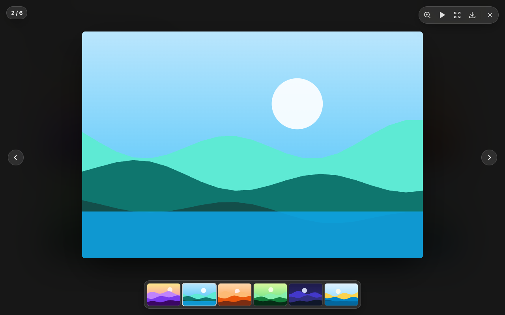
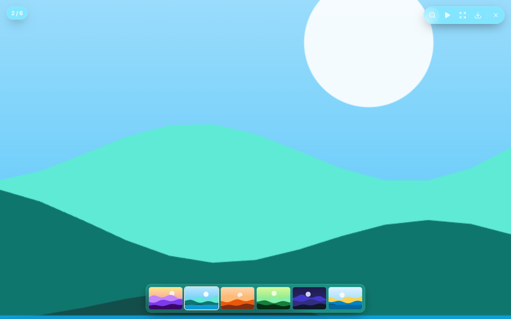
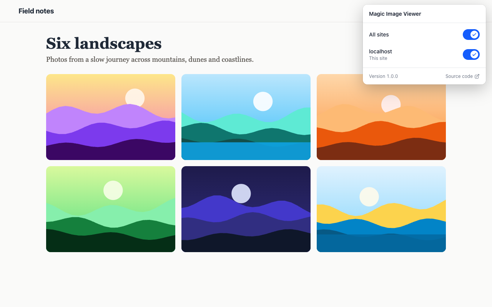

<p align="center">
  
</p>

<h1 align="center">Magic Image Viewer</h1>

<p align="center">
A browser extension for Chrome and Firefox that opens any image on any web page in a full-screen
viewer — with zoom, pan and a gallery of every picture on the page.
</p>

<p align="center">
  <b>Chrome Web Store</b> · <b>Firefox Add-ons</b> · <b>Microsoft Edge Add-ons</b> — coming soon
</p>



## Features

- **Click to open.** A click on a photo opens the viewer; step through every picture of the page
  with the arrows, the thumbnail strip, swipes or the keyboard.
- **Zoom and pan.** Zoom at the pointer with the wheel or a click on the picture, double tap or
  pinch on touch screens, drag to pan.
- **The largest version.** Uses a linked full-size file, the largest `srcset` or `<picture>`
  candidate, or common full-size data attributes, and falls back when a link is not an image.
- **Leaves the page alone.** Logos, icons, avatars and images in buttons never open. Links to other
  pages keep working — Alt-click opens their image instead. Swipeable carousels keep swiping. The
  site's own lightbox stays closed.
- **Image tabs and context menu.** An image opened on its own in a tab is shown in the viewer, and
  "Show in Magic Image Viewer" in the context menu opens any image.
- **Your choice per site.** The popup switches the viewer off for all sites or for the current one.
- **Eight languages.** English, German, French, Spanish, Italian, Portuguese, Dutch and Polish,
  following the browser's language.
- **Private.** No data leaves the browser — see [PRIVACY.md](PRIVACY.md).

| Zoomed in | Popup |
| --- | --- |
|  |  |

## Using it

| Action | How |
| --- | --- |
| Open an image | Click it. For an image that links to another page: Alt-click. |
| Next / previous | Arrow keys, the side buttons, a swipe or the thumbnails |
| Zoom | Mouse wheel, a click on the picture, double tap or pinch, or the zoom button |
| Close | Esc, the close button, or a click beside the picture |
| Any image | Right-click → Show in Magic Image Viewer |
| Switch off | Toolbar button → All sites / This site |

## Install

| Store | Link |
| --- | --- |
| Chrome Web Store | Coming soon |
| Firefox Add-ons | Coming soon |
| Microsoft Edge Add-ons | Coming soon |

### From source

Requirements: Node.js 24 and npm.

```sh
npm ci
npm run build            # Chrome → dist/chrome-mv3
npm run build:firefox    # Firefox → dist/firefox-mv3
```

- **Chrome:** open `chrome://extensions`, switch on developer mode, choose "Load unpacked" and
  select `dist/chrome-mv3`.
- **Firefox:** open `about:debugging#/runtime/this-firefox`, choose "Load Temporary Add-on" and
  select `dist/firefox-mv3/manifest.json`.

`npm run zip` and `npm run zip:firefox` build the store packages, the latter together with the
source package for the Firefox review.

## Development

```sh
npm run dev              # Chrome with live reload
npm run dev:firefox
npm test                 # unit tests, test build, Playwright tests with the extension loaded
npm run icons            # renders public/icons from assets/icon
```

Built with [WXT](https://wxt.dev), Vue 3 and Tailwind CSS 4. The viewer is the `Lightbox` of
[laravel-islands-gallery](https://github.com/jonaaix/laravel-islands-gallery), its buttons and the
popup's controls come from [laravel-islands](https://github.com/jonaaix/laravel-islands). The viewer
runs inside a Shadow DOM, so pages and viewer do not affect each other's styles.

## Support

Magic Image Viewer is free and stays free. If it saves you time, you can buy me a coffee:

<a href="https://buymeacoffee.com/jonaaix"></a>

## Licence

[MIT](LICENSE)
